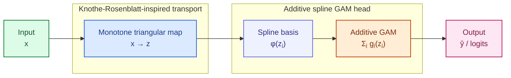

# KRAN: Knothe-Rosenblatt Additive Network

**A monotone transport–additive neural network for interpretable tabular classification and regression.**

KRAN combines a learned **Knothe-Rosenblatt-inspired monotone triangular transformation** with a **strictly additive spline prediction head**. The transport adapts the input representation to a supervised prediction task, while the additive head provides explicit, inspectable contributions for each transported coordinate. The repository includes the PyTorch implementation, benchmark and ablation pipelines, numerical diagnostics, original-input explanation methods, and automated tests.

**Author:** Mücahit Cihan · Department of Electrical and Electronics Engineering, Konya Technical University, Türkiye.

## Architecture

KRAN follows a **transport-then-additive** design. The KR-MonoMap learns a supervised, monotone triangular transformation of the preprocessed inputs, and the spline-based GAM head produces an explicitly additive prediction in the transported coordinate space.



The transport produces $z=(z_1,\ldots,z_d)$, where $z_j=T_j(x_1,\ldots,x_j)$ depends only on the first $j$ input coordinates. Each $z_j$ is expanded independently into local spline basis functions $\phi_m(z_j)$, and the corresponding effect $g_j(z_j)$ contributes additively to a regression output or a class logit. The diagram represents the **main additive KRAN model**, not the optional non-additive head variants used in architectural experiments.

## Method

Let $x=(x_1,\ldots,x_d)\in[0,1]^d$ denote a preprocessed input vector. KRAN first computes $z=T(x)$ using a lower-triangular map. For coordinate $j$,

$$
z_j = T_j(x_{1:j}) =
\frac{\int_0^{x_j}\rho\!\left(s_j(x_{1:j-1},t)\right)\,dt}
     {\int_0^1\rho\!\left(s_j(x_{1:j-1},t)\right)\,dt},
$$

where $s_j$ is a trainable conditional scalar network and $\rho$ is a strictly positive activation (softplus by default). Numerator and denominator are approximated with trapezoidal quadrature. For fixed preceding inputs, each $T_j$ increases with $x_j$; the resulting map has a triangular dependency structure. Monotonicity applies to **each transport coordinate in its own input**, not to the complete predictor.

A local hat-spline basis is evaluated independently at each transformed coordinate. The main prediction head is additive:

$$
f(x) = b + \sum_{j=1}^{d}g_j\bigl(T_j(x_{1:j})\bigr), \qquad
 g_j(z_j) = \sum_{m=1}^{M} w_{jm}\,\phi_m(z_j).
$$

For regression, the expression produces one or more continuous outputs. For classification, output-specific spline coefficients produce **additive class logits**, converted into probabilities with softmax. Binary classification uses two logits.

**Interpretation boundary.** Additive decomposition is exact for the **transported coordinates** $z_j$, not for independent contributions of raw input features. Changing an original feature $x_j$ may alter its own transported coordinate and later coordinates $z_{j+1},\ldots,z_d$. KRAN therefore provides reference-conditioned original-input responses with **direct-coordinate** and **downstream-transport** components. These are responses of a trained model, **not causal effects**.

### Core implementation

- **KR-MonoMap:** positive conditional scores, normalized integrals, configurable trapezoidal quadrature, triangular transport, and optional log-Jacobian diagnostics.
- **Spline expansion:** uniform, piecewise-linear, locally supported hat bases on $[0,1]$.
- **Additive head:** per-coordinate spline effects, output-specific coefficients, and an explicit bias.
- **Alternative heads for controlled experiments:** identity transport, linear readout, and a non-additive spline-MLP readout.
- **Optional penalties:** covariance-based decorrelation, HSIC-based dependence control, and second-difference spline smoothness. These penalties are **disabled in the main benchmark configuration**; AdamW weight decay is separate.
- **Diagnostics and explanations:** finite-difference monotonicity, approximate inverse reconstruction, transported effects, reference-conditioned feature responses, Integrated Gradients, permutation reliance, and optional approximate SHAP.

## Repository layout

```text
KRAN/
├── kran/                  Model, spline layers, data handling, training,
│                          baselines, metrics, diagnostics, explanations
├── experiments/           Benchmark, ablation, robustness, ordering,
│                          interpretation, and scalability entry points
├── examples/              Minimal, end-to-end example using bundled sklearn data
├── scripts/               Run-integrity checking utility
├── tests/                 Unit and protocol tests
├── .github/workflows/     Continuous-integration tests
├── .gitignore
├── README.md
├── CITATION.cff
├── pyproject.toml
└── requirements.txt
```

Experimental output files, model checkpoints, downloaded data, and other generated artifacts are **not committed** to this repository. Experiment commands create `results/generated/` locally when needed; this directory is excluded from version control.

## Installation

Python 3.10 is recommended.

Clone or download this repository, navigate to its root directory,
and install KRAN with the required dependencies:

```bash
python -m pip install --upgrade pip
python -m pip install -e ".[experiments,test]"
```

Replace `<owner>/<repository>` with the actual GitHub location. If you need a GPU-specific PyTorch build, install the appropriate wheel according to the [official PyTorch installation instructions](https://pytorch.org/get-started/locally/) before installing KRAN. The installed PyTorch build, CUDA runtime, GPU, and package versions should be recorded when comparing computational measurements. Some experiment datasets are downloaded from scikit-learn/OpenML on first use and require network access.

To install only the core package and its required dependencies:

```bash
python -m pip install -e .
```

## Quick start

### End-to-end classification example

The included example performs a stratified training/test split, fits MinMax preprocessing **only on the training set**, trains KRAN, and evaluates held-out classification predictions using the Breast Cancer dataset packaged with scikit-learn.

```bash
python -m examples.train_breast_cancer --epochs 5 --device cpu
```

This is a minimal working example, not the complete benchmark evaluation.

### Use the model in Python

```python
import torch
from kran import KRAN, KRANConfig

config = KRANConfig(
    input_dim=8,
    output_dim=1,
    task="regression",
    mono_hidden_dims=(64, 64),
    mono_integrand="softplus",
    mono_num_quad_points=32,
    spline_num_knots=16,
    head_type="additive",
)

model = KRAN(config).eval()

# Illustration only: in applications, fit preprocessing on the training data.
x_scaled = torch.rand(4, 8)  # [batch, features], values in [0, 1]

with torch.no_grad():
    prediction, details = model(x_scaled, return_extras=True)

print(prediction.shape)  # torch.Size([4, 1])
print(details["z"].shape)  # torch.Size([4, 8])
print(details["log_det"].shape)  # torch.Size([4])
```

`model(x)` returns regression predictions or **unnormalized logits**. For classification, pass logits through `torch.softmax(logits, dim=1)` to obtain class probabilities. The `log_det` output is an optional transport diagnostic, not a likelihood objective used to train the default model.

## Experimental evaluation

The repository provides two distinct evaluation workflows: **fixed-budget experiments** for component-level analyses, and a **repeated nested-holdout benchmark** for predictive comparison. Their results should not be pooled because their training budgets, model-selection procedures, and regression target treatment differ.

### Datasets and tasks

- **Breast Cancer:** binary classification, 569 observations, 30 numerical features.
- **Adult Income:** binary classification with numerical and categorical predictors; categorical columns are one-hot encoded using training-derived categories.
- **Covertype:** seven-class classification on a fixed 50,000-observation subset, sampled with seed 42.
- **Energy Efficiency:** joint two-output regression for heating and cooling loads.
- **California Housing:** single-output regression, 20,640 observations and 8 input features.
- **YearPredictionMSD:** single-output regression with 90 input features; the first 50,000 observations returned by the configured data source are used.

Dataset definitions, availability, and source versions can affect run comparability. The loader checks expected data dimensions. Data are not bundled in the source package.

### Repeated nested-holdout benchmark

This pipeline compares **KRAN plus nine reference model families**: MLP, KAN-style spline network, GAM, FT-Transformer-lite, RandomForest, HistGradientBoosting, XGBoost, LightGBM, and CatBoost.

- Five outer holdout seeds: **1042–1046**; 80% outer training / 20% outer test.
- An 80/20 inner-training/validation split of each outer-training partition, with split seed derived from the outer seed.
- Classification splits are stratified; regression splits use random partitioning.
- Feature transformations and categorical encoding are fit only on the applicable training partition.
- KRAN chooses between **16 and 32 spline knots**, with **32 quadrature points**, and selects its training epoch using inner-validation loss.
- Neural models use up to **150 epochs**, early-stopping patience **20**, AdamW, and gradient clipping (maximum norm **5**). Neural regression targets are standardized using training-only statistics and converted back to original units for validation and test metrics.
- RandomForest and HistGradientBoosting use specified fixed configurations. XGBoost, LightGBM, and CatBoost choose between two predefined parameter configurations on the inner validation data.
- After selection, neural models are **reinitialized** and refit on the complete outer-training partition for the selected epoch count; boosted models are refit with the selected configuration.
- The full default matrix contains **6 datasets × 10 model families × 5 outer seeds = 300 runs**. This is a computationally intensive workflow.

```bash
# Complete default benchmark
python -m experiments.run_repeated_holdout

# Validate dataset/model/seed coverage and matching data fingerprints
python scripts/audit_generated_runs.py results/generated/repeated_holdout/run_level.csv
```

For a short pipeline check, use a **separate output directory** and a deliberately reduced training budget:

```bash
python -m experiments.run_repeated_holdout \
  --datasets breast_cancer --models KRAN,MLP --seeds 1042 \
  --max-epochs 2 --device cpu --output results/generated/smoke
```

On Windows PowerShell, place the entire command on one line or replace the shell continuation characters with PowerShell backticks. Smoke-test scores should not be compared with the full benchmark. For an interrupted full run, `--resume` skips complete dataset/model/seed records already present in the selected output CSV; it does not reconstruct partial model states.

The benchmark writes run-level metrics, selected settings, timing records, split indices, and data-partition fingerprints. Unless `--no-checkpoints` is specified, KRAN checkpoints are stored under `results/generated/repeated_holdout/checkpoints/`. The audit script requires the complete 300-run matrix and will intentionally mark smaller runs incomplete.

### Fixed-budget studies and diagnostics

Each of the following commands has a dedicated purpose. They can require substantial computation or external dataset downloads; execute from the repository root.

```bash
# Fixed-budget multi-dataset benchmark and architectural variants
python -m experiments.run_main_benchmarks
python -m experiments.run_ablation
python -m experiments.run_five_seed_ablation

# Numerical and regularization studies
python -m experiments.run_quadrature_diagnostics
python -m experiments.run_regularization
python -m experiments.run_normalization
python -m experiments.run_noise_robustness

# Feature ordering and internal additive-component stability
python -m experiments.run_feature_ordering
python -m experiments.run_interpretability_stability
```

The quadrature diagnostic evaluates the transport's sampled monotonicity, finite-difference derivatives, and inverse reconstruction. Normalization alternatives include training-fitted MinMax, robust MinMax, quantile-uniform, and standard-CDF transforms. Regularization experiments examine correlation-based, HSIC-based, and spline-smoothness penalties as optional mechanisms rather than assumptions of feature independence.

### Original-feature explanations and ordering controls

The following analyses use **trained KRAN checkpoints** created by `run_repeated_holdout`. Run the relevant Breast Cancer KRAN seeds first. These methods analyze original-input responses of the complete prediction function, not just its associated transported-coordinate spline term.

```bash
# Reference-conditioned direct + downstream response decomposition
python -m experiments.run_original_feature_responses

# Integrated Gradients, permutation NLL, optional approximate Kernel SHAP
python -m experiments.run_original_feature_attributions --seed 1042 --steps 1024

# Add --shap to enable the more computationally expensive SHAP comparison.

# Fixed-weight numerical quadrature convergence (requires the selected checkpoint)
python -m experiments.run_fixed_weight_quadrature --dataset breast_cancer --seed 1042
```

The response analysis uses training-derived reference profiles and feature grids; for binary Breast Cancer classification, the log-odds contrast is **malignant (class 0) minus benign (class 1)**. Direct and downstream terms reconstruct the total response on the log-odds scale. Probability changes need not decompose additively. Percentile bands across reference profiles describe variation across input contexts, not statistical confidence intervals. Correlated-feature interventions can produce unrealistic input combinations; none of these outputs establishes causality.

The ordering-control pipeline compares four feature arrangements on the Breast Cancer data over five splits and two initialization restarts. It uses the epoch/knot selections from the corresponding original-order KRAN runs and saves separate model checkpoints for explanation comparison.

```bash
# Requires completed Breast Cancer KRAN run-level records
python -m experiments.run_controlled_ordering

# Requires the restart-1 checkpoints produced by the command above
python -m experiments.run_ordered_explanations
```

The separate `run_feature_ordering` entry point explores additional ranking-based and random permutations under a fixed-budget protocol; it is not interchangeable with the controlled four-order workflow. The internal effect-ranking stability experiment measures coefficient-based rankings, which are not invariant original-input feature-importance estimates.

### Synthetic scalability

```bash
python -m experiments.run_scalability
```

This experiment examines feature dimensionalities **25, 50, 100, 200, 500** and quadrature resolutions **8, 16, 32**, using 5,000 synthetic samples and five training epochs per configuration. Each pair is executed in a separate Python process. When CUDA is available, it records PyTorch-allocator peak allocated/reserved memory in MiB; these figures exclude allocations made outside that allocator. Training/inference times are backend-dependent, and GPU/CPU measurements are not treated as hardware-matched comparisons.

## Metrics and reproducibility

- **Classification:** accuracy, macro-F1, binary ROC-AUC where applicable, negative log-likelihood, confidence-based expected calibration error, and multiclass Brier score. For binary problems, the implemented multiclass Brier definition is twice the single-positive-class binary Brier score.
- **Regression:** mean squared error, mean absolute error, and $R^2$, evaluated in original target units for the repeated benchmark.
- **Numerical transport checks:** monotonicity violation rate, finite-difference derivatives, inverse reconstruction error, and quadrature sensitivity.
- **Original-input inspection:** feature-response decomposition, Integrated Gradients completeness, permutation-based predictive reliance, and optional approximate SHAP additivity checks.
- **Efficiency:** model parameters, measured training/inference times, and CUDA memory diagnostics in the scalability workflow.

Seeds and training partitions are specified in the source; preprocessing is fitted to training data only. Checkpoints and dataset fingerprints support verification of local follow-on analyses. Results can still vary with upstream dataset versions, software builds, computation hardware, numerical kernels, and execution settings. Tests establish structural and numerical invariants, **not** bitwise agreement between independently executed benchmark runs.

## Testing

```bash
python -m pytest -q
```

The test suite checks model shapes and bounds, exact additive-head reconstruction, sampled transport monotonicity, direct/downstream decomposition, Integrated Gradients completeness on a linear reference model, leakage-aware preprocessing, deterministic split disjointness, and reference parameter counts. GitHub Actions runs these tests on pushes and pull requests.

## Citation

Please use the repository's [`CITATION.cff`](CITATION.cff) for software metadata. When citing the associated research paper, use its verified bibliographic information once available. No publication venue or DOI is asserted by this repository.

## License

No software license is specified in this repository. Access to the source code does **not** by itself grant redistribution, modification, or commercial-use rights. Contact the repository owner for permission unless a license is subsequently added.
